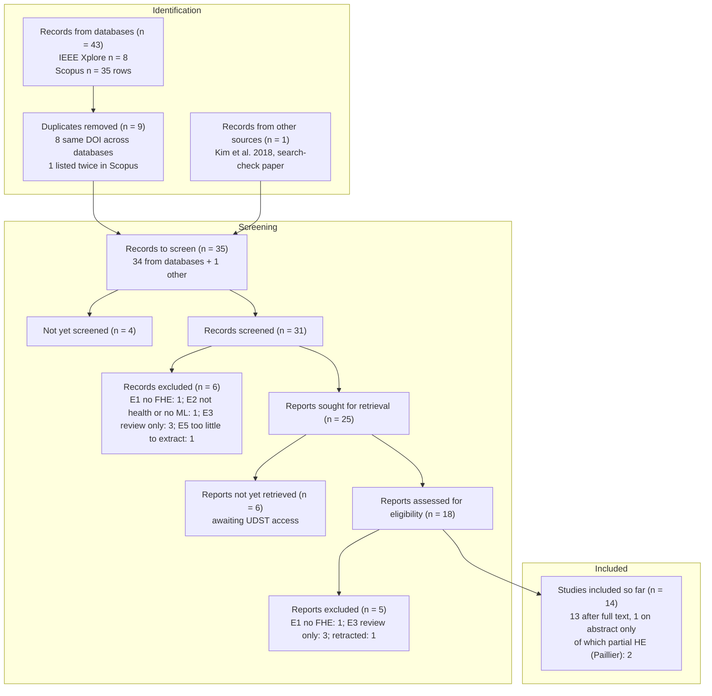

# PRISMA 2020 flow – refined search (generated)

Generated by `research/slr/scripts/prisma_counts.py` from
[screening-decisions.csv](screening-decisions.csv). **Do not edit by hand.**

## As reported in Progress Report 2 (Table 2, 7 Nov 2026)

34 records to screen · 31 unique records screened · 11 excluded · 12 included · 2 borderline ·
6 awaiting full text. These remain the numbers as submitted on 8 Nov.

## Changes after PR2 (11 Nov, decisions #14 and #17)

- MediVault and Akter (the 2 borderline records, Paillier) are **included** as a *partial HE*
  subgroup (decision #17).
- The 4 records missing from Table 3 are assigned for Week 12 (decision #14).

## Reconciled with the sheet (this file)

PR2 assumed the 3 records read twice (Heartify, Sayyad and Kulkarni, ICSCSP 2018) explain the gap
between 34 and 31. Checking every sheet ID shows instead that **4 records were
never assigned** (P002 Dziri 2025, P011 Janagama 2026, P023 ICIC 2019, P029 Dakhare 2024), and that
Kim et al. 2018 (BMC Med Genomics), which Saif screened, is **not in the refined search results**:
it is a search-check paper and must be counted under *identified from other sources*.

## Numbers

| Box | n |
|---|---|
| Records identified from databases (IEEE 8 + Scopus 35) | 43 |
| Duplicates removed | 9 |
| Records from other sources | 1 |
| Records to screen | 35 |
| Not yet screened | 4 |
| Screened | 31 |
| Excluded at title/abstract/record | 6 |
| Excluded after reading the full text | 5 |
| Included (full text read) | 13 |
| Included (abstract only – full text still to read) | 1 |
| of which partial HE (Paillier) subgroup, decision #17 | 2 |
| Borderline | 0 |
| Awaiting full text | 6 |

PRISMA 2020 puts exclusions made after reading the full text in the *Reports excluded* box (with
reasons), not with title/abstract exclusions. PR2 grouped all 11 together; the final report should
use the split above.
